<div align="center">


# Jama'ah · جماعة

### *Prayer-times app that counts down to the iqamah and tells you when to leave for the mosque*

[](https://dart.dev)
[](https://flutter.dev)
[](https://bloclibrary.dev)
[](https://aladhan.com/prayer-times-api)
[](#-localization)

🌐 **English** | [العربية](README.ar.md)

[](https://abed232822-stack.github.io/Jamaah/)

📲 **Download page:** https://abed232822-stack.github.io/Jamaah/

</div>

---

## 📖 Table of Contents

- [📌 Project Overview](#-project-overview)
- [🎬 Splash Animation](#-splash-animation)
- [📸 Screenshots](#-screenshots)
- [✨ Key Modules & Features](#-key-modules--features)
- [📱 System Architecture](#-system-architecture)
- [📁 Project Directory Structure](#-project-directory-structure)
- [🧠 State Management & Data Flow](#-state-management--data-flow)
- [⏱️ Prayer Schedule Rules](#️-prayer-schedule-rules)
- [🔔 Notifications](#-notifications)
- [🗂️ Local Storage Model](#️-local-storage-model)
- [🌐 Remote APIs](#-remote-apis)
- [🌍 Localization](#-localization)
- [🛠️ Tech Stack & Dependencies](#️-tech-stack--dependencies)
- [🎨 UI & Design System](#-ui--design-system)
- [💡 How It Works](#-how-it-works)

---

## 📌 Project Overview

**Jama'ah** is a prayer-times app with one core job: tell you the adhan, count down to the
**iqamah**, and remind you when to **leave for the mosque** so you catch the jama'ah. Pick a place
once, and the home screen shows the next prayer, the iqamah countdown after the adhan, and a
"leave now" cue computed from your walking time — all with Arabic (RTL) as the default language and
a warm dark/light theme that follows the system.

The app has no account and no backend of its own. Prayer times are fetched from the AlAdhan API one
month at a time and kept on the device, so the network is only used for a month that is not cached
yet. It is built with Flutter, with local notifications on the mobile platforms.

> The source code is private. This page describes the product and how it is built.

### Architectural Goals:

- **Feature Decoupling**: Features (`home`, `location`, `settings`, `splash`) never import each
  other. Anything shared lives in `core/`.
- **Predictable State Management**: Immutable `Equatable` states driven by Cubits
  (`AppSettingsCubit`, `PrayerDaysCubit`, `HomeCubit`, `LocationSearchCubit`, `IqamahTimesCubit`,
  `NotificationAccessCubit`).
- **Pure Schedule Rules**: The rules of the day (which prayer is next, when the iqamah is, when to
  leave) live in plain Dart classes with no Flutter or network code, so they are unit-tested.
- **Offline-First Times**: A month of prayer times is cached in `shared_preferences`; the cache is
  read first and the network is only used for a month that is missing.
- **Adaptive Layout**: Space tokens instead of literal sizes, 48dp tap targets, a text-scale clamp
  of 1.4, and a two-column Home at 840dp and wider.
- **Central Error Handling**: Every network failure becomes an `ApiException` with a localized
  message through one `ApiErrorHandler`.

---

## 🎬 Splash Animation

A silent first-launch animation (~7.4 s) recreated natively in Flutter from the design handoff — a
ticker-driven scene, shown **once**, and skipped when the system has animations disabled. Tapping
the screen finishes it early.

<div align="center">

<a href="Jamaah%20Handoff/splash-video/Jamaah%20Splash%20Video.mp4">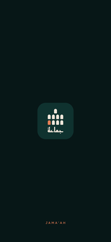</a>

**▶ [Watch the splash video](<Jamaah Handoff/splash-video/Jamaah Splash Video.mp4>)** · 1080×1920 · silent

</div>

| Scene | Length | What happens |
|---|:---:|---|
| **Gather** | 0.7 s | The imam and two rows fade in, with an empty place at the end of the last row |
| **Walk** | 2.4 s | The terracotta worshipper (*you*) walks in from the left and slows down toward the empty place |
| **Settle** | 0.5 s | The worshipper steps into place and settles with a small squash |
| **Takbir** | 1.4 s | A soft «الله أكبر» rises above the imam, rings spread out and the rows bow slightly |
| **Name** | 1.4 s | «جماعة» rises from the bottom into place and the takbir fades out |
| **Hold** | 1.0 s | The finished logo holds with `JAMA'AH` at the bottom |

The logo is **الصفّ (The Rows)**: the imam stands in front, two rows stand behind, and the
terracotta figure completing the last row is *you* joining the jama'ah.

---

## 📸 Screenshots

Dark theme, Arabic (RTL, Arabic-Indic digits) — the default experience. The place is Cairo (Egypt) and the Home
states show Asr on a Friday. The notification screen is the design mock-up.

### 🌙 First run

| Where do you pray? | Place search |
| :---: | :---: |
| 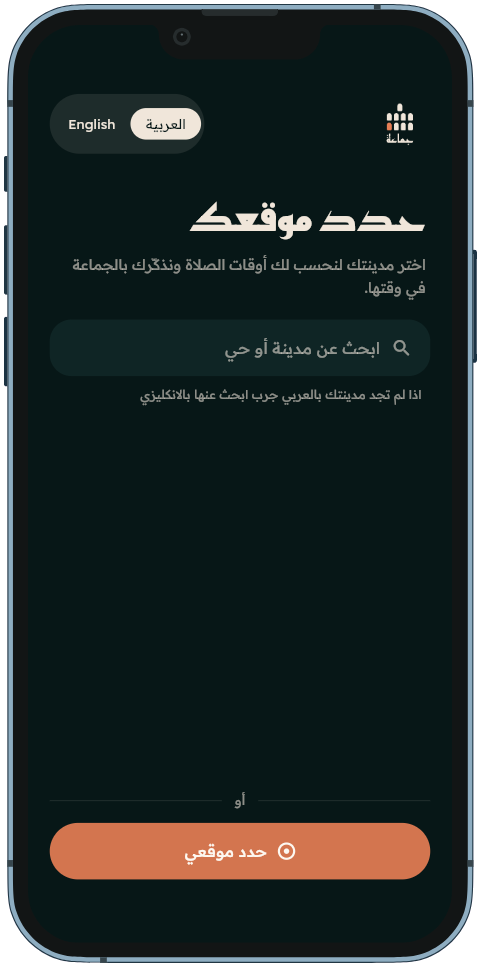 | 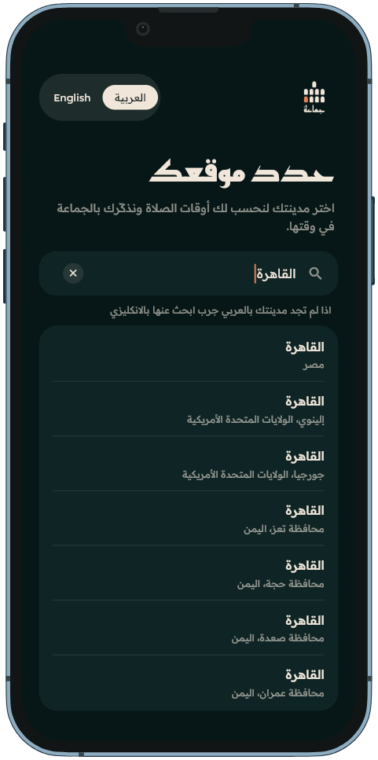 |

### 🕌 Home

| Before the adhan | Iqamah countdown | Leave now |
| :---: | :---: | :---: |
| 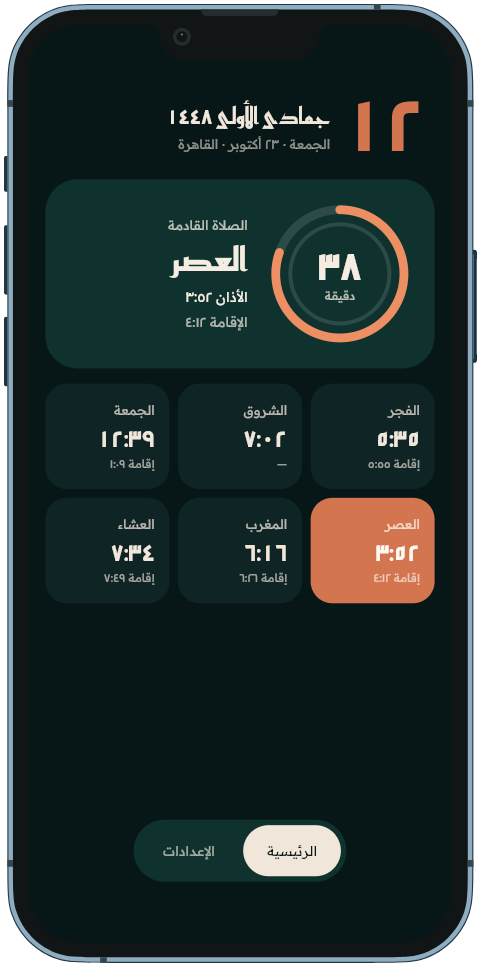 | 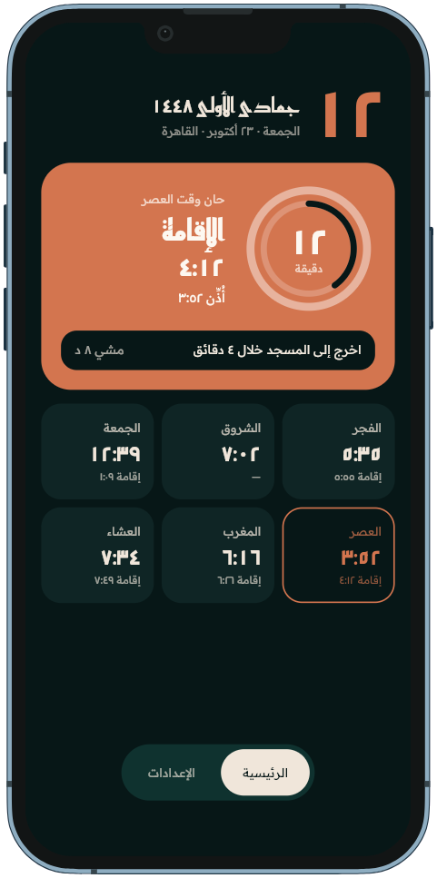 | 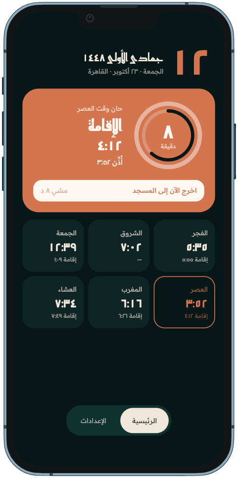 |

| Adjust iqamah sheet | Leave notification |
| :---: | :---: |
| 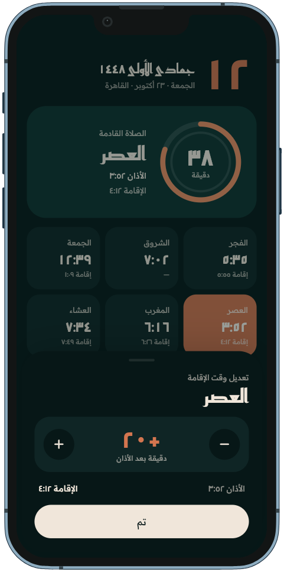 |  |

### ⚙️ Settings

| Settings | Iqamah times |
| :---: | :---: |
| 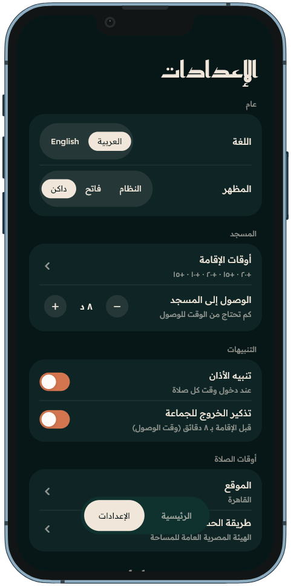 | 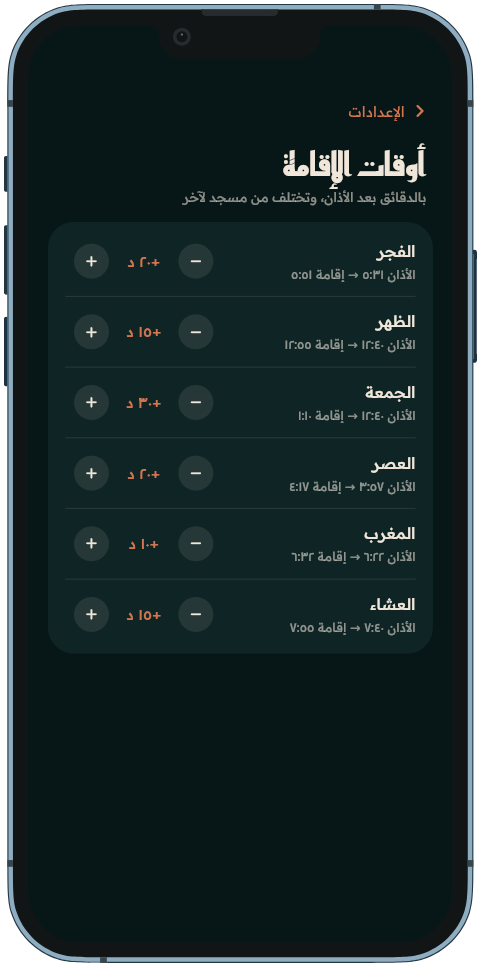 |
| **Location** | **Calculation method** |
| 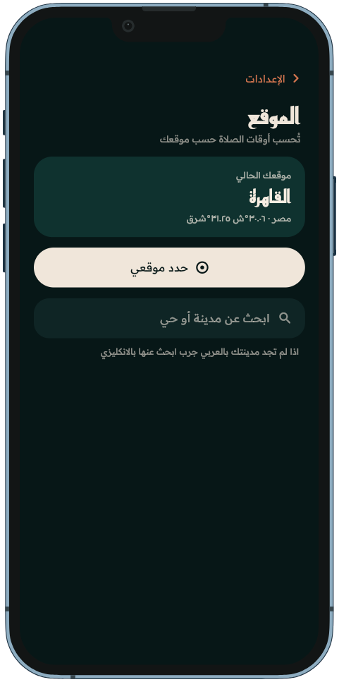 | 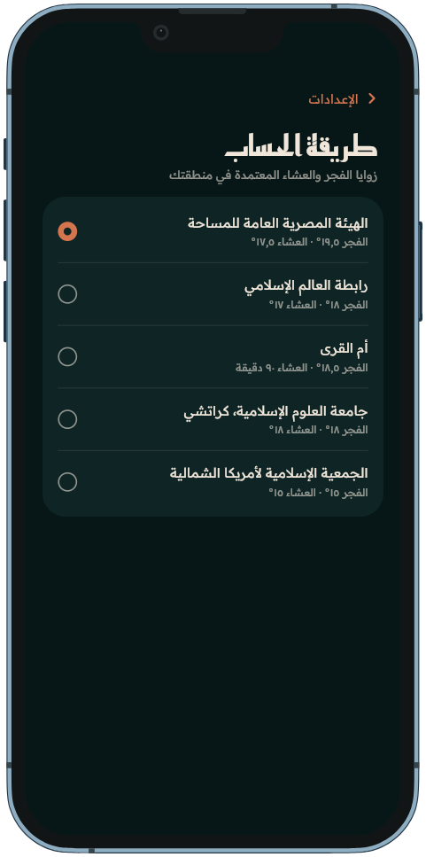 |

### 🌐 English (LTR, Latin digits)

| Home | Settings |
| :---: | :---: |
| 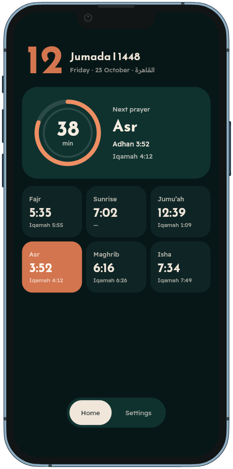 | 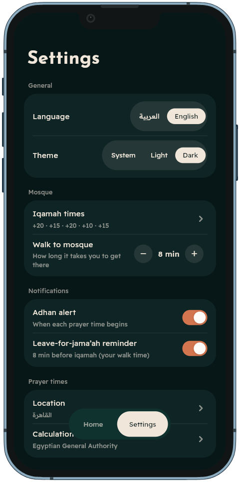 |

---

## ✨ Key Modules & Features

### 1. 🕌 Home (`features/home`)

- **Two-Ring Countdown**: The outer ring counts down to the next adhan; once the adhan is called, the
  inner ring counts down to the iqamah. Drawn with a custom canvas widget.
- **Next-Prayer Hero**: Prayer name, countdown and the Hijri date header.
- **Leave Chip**: Shows the time left until you should leave, then switches to **Leave now** once
  `iqamah − walk time` has passed.
- **Prayer Tile Grid**: Fajr, Sunrise, Dhuhr (Jumu'ah on Fridays), Asr, Maghrib and Isha with adhan
  and iqamah times. Tap a tile to open the **Adjust iqamah** sheet.
- **Loading & Error States**: Dedicated loading and error widgets, with a wide two-column layout at
  840dp and above.

### 2. 📍 Location (`features/location`)

- **Onboarding**: First-run "Where do you pray?" screen with predictive place search and a
  **Use my location** button.
- **Debounced Search**: Search starts at 2 characters with a 280 ms debounce and returns up to 7 places.
- **Use My Location**: GPS fix, reverse-geocoded to a place name, with the timezone looked up from
  coordinates; falls back to raw coordinates and the device zone if an optional lookup fails.
- **Location Screen**: Current place card, locate-me and search, reachable from Settings.

### 3. ⚙️ Settings (`features/settings`)

- **General**: Arabic / English switch and a System / Light / Dark theme switch.
- **Mosque**: Per-prayer iqamah offsets (Jumu'ah separate) on their own screen, plus the walking
  time to the mosque.
- **Prayer Times**: Location and calculation-method screens.
- **Notifications**: Separate toggles for the adhan alert and the leave alert, with a notice when
  the system has blocked notifications.

### 4. 🎬 Splash (`features/splash`)

- First-launch animation described [above](#-splash-animation); `splashSeen` is persisted so it
  never plays twice.

### 5. 🧱 Core (`core/`)

- Theme and palette, localization, settings store, prayer-time data and rules, networking,
  notifications and shared widgets — see [Project Directory Structure](#-project-directory-structure).

---

## 📱 System Architecture

Each feature is split into `data` and `presentation`. Cubits depend on repositories and services
injected through `GetIt`; they never call Dio from the UI or from a Cubit.

```
    ┌─────────────────────────────────────────────────────────────┐
    │                      Presentation Layer                     │
    │  ┌──────────────────────┐     ┌───────────────────────┐     │
    │  │  Screens & Widgets   │◀────│  Cubits (State only)  │     │
    │  │ (ring, hero, tiles,  │────▶│ Home / LocationSearch │     │
    │  │  settings rows)      │     │ IqamahTimes / Settings│     │
    │  └──────────────────────┘     └───────────┬───────────┘     │
    └───────────────────────────────────────────┼─────────────────┘
                                                │
                  ┌─────────────────────────────┼───────────────────────┐
                  ▼                             ▼                       ▼
    ┌──────────────────────────┐  ┌───────────────────────┐  ┌──────────────────────┐
    │ PrayerTimesRepository    │  │ LocationRepository    │  │ PrayerAlarmScheduler │
    │  ├─ AladhanRemoteSource  │  │  ├─ LocationRemote    │  │  ├─ PrayerAlarmPlanner│
    │  └─ PrayerTimesCache     │  │  └─ CurrentLocation   │  │  └─ LocalNotification │
    └──────────────────────────┘  └───────────────────────┘  └──────────────────────┘
                  ▲
                  │ ApiClient (Dio) + central ApiErrorHandler → ApiException
    ┌─────────────┴───────────────────────────────────────────────┐
    │                       Core (lib/core)                       │
    │  (PrayerSchedule rules, AppPalette, l10n, SettingsStorage,  │
    │   AppSettingsCubit, shared *_widget.dart components)        │
    └─────────────────────────────────────────────────────────────┘
```

### Highlights:

1. **Dependency Injection**: A single `GetIt` container in
   `lib/core/injection/injection.dart` registers settings,
   the API client, data sources, repositories, services and the long-lived Cubits as singletons;
   screen-scoped Cubits (`HomeCubit`, `LocationSearchCubit`, `IqamahTimesCubit`) are factories.
2. **Single Source of Settings**: `AppSettingsCubit` is the one place settings change; the root app
   widget listens only to `(language, themeMode)` with a `BlocSelector` to avoid rebuilding the app.
3. **Startup Safety Net**: `main()` wraps dependency setup in a try/catch and shows
   `AppStartupErrorWidget` instead of a blank screen if it fails.
4. **Root Flow**: `AppRootScreen` picks Splash → Onboarding (no saved place) → App shell (Home +
   Settings tabs with a floating bottom nav), cross-fading between them.
5. **One Import for Core**: `lib/core/core_kit.dart` re-exports the core
   surface so features write a single import.

---

## 📁 Project Directory Structure

```plaintext
lib/
├── core/
│   ├── constants/                      #   AppConstants (defaults, limits, keys), AppDimens (tokens)
│   ├── injection/                      #   GetIt container: configureDependencies()
│   ├── l10n/                           #   app_ar.arb, app_en.arb + generated AppLocalizations
│   ├── models/                         #   AppSegment, AppNavItem, AppButtonStyle
│   ├── network/                        #   ApiClient (Dio), ApiEndpoints, ApiErrorHandler, ApiException
│   ├── notifications/                  #   NotificationAccessCubit (permission state)
│   ├── prayer_times/
│   │   ├── data/                       #   AladhanRemoteDataSource, PrayerTimesCache, repository, models
│   │   ├── prayer_schedule.dart        #   Pure rules of the day (snapshot, events)
│   │   ├── prayer_alarm_planner.dart   #   Turns days + settings into alarms
│   │   └── prayer_days_cubit.dart      #   Loads times for the saved place
│   ├── routing/                        #   App widget, root screen, shell, router, page route
│   ├── services/                       #   LocalNotificationService, CurrentLocationService, scheduler
│   ├── settings/                       #   AppSettingsState/Cubit, SettingsStorage, SavedLocation
│   ├── theme/                          #   AppPalette (light/dark), AppColors, AppTextStyles, AppTheme
│   ├── utils/                          #   AppClock, Countdown, LocationTime, digit/time formatting
│   ├── widgets/                        #   Shared *_widget.dart (nav, switch, stepper, rows, buttons)
│   └── core_kit.dart                   #   Single import for the core surface
│
├── features/
│   ├── home/
│   │   ├── data/models/                #   Header / Hero / Ring / Tiles view models
│   │   └── presentation/
│   │       ├── bloc/                   #   HomeCubit, HomeState
│   │       ├── screens/                #   HomeScreen
│   │       └── widgets/                #   Countdown ring, hero, tile grid, adjust-iqamah sheet
│   │
│   ├── location/
│   │   ├── data/                       #   Remote data source, repository, place/geocode models
│   │   └── presentation/
│   │       ├── bloc/                   #   LocationSearchCubit, state
│   │       ├── screens/                #   OnboardingScreen, LocationScreen
│   │       └── widgets/                #   Search field, results, locate-me, current location card
│   │
│   ├── settings/
│   │   ├── data/models/                #   IqamahRowModel
│   │   └── presentation/
│   │       ├── bloc/                   #   IqamahTimesCubit, state
│   │       ├── screens/                #   Settings, Iqamah times, Calculation method
│   │       └── widgets/                #   Section widgets, method row, theme switch
│   │
│   └── splash/
│       └── presentation/
│           ├── screens/                #   SplashAnimationScreen (ticker)
│           └── widgets/                #   SplashSceneWidget (the animation scene)
│
└── main.dart                           # Entrypoint: DI, alarm scheduler start, runApp

assets/
├── fonts/                              # Reem Kufi, Readex Pro (+ OFL licenses)
├── images/                             # App icon (light / dark)
└── native/                             # Source art for launcher icons & native splash

```

---

## 🧠 State Management & Data Flow

```
[Saved location + method]
          │
          ▼
  [PrayerDaysCubit] ── loadDays ──▶ [PrayerTimesRepository]
          │                              │        │
          │                    cache hit │        │ cache miss
          │                              ▼        ▼
          │                      PrayerTimesCache  AladhanRemoteDataSource (Dio)
          │
          ├── PrayerDaysState (ready) ──▶ [HomeCubit] ── PrayerSchedule.snapshot ──▶ [Home UI]
          │                                   ▲
          │                       periodic tick + settings
          │
          └── stream ──▶ [PrayerAlarmScheduler] ── PrayerAlarmPlanner ──▶ [Local notifications]
```

### The Cubits:

| Cubit | Responsibility | State |
|---|---|---|
| `AppSettingsCubit` | Language, theme, iqamah offsets, walk time, alert toggles, location, method, splash-seen | `AppSettingsState` (immutable, JSON round-trip) |
| `PrayerDaysCubit` | Loads and holds the prayer days for the saved place and method | `PrayerDaysState` |
| `HomeCubit` | Builds the header, hero, ring and tiles models from the current snapshot | `HomeState` (`idle`, `loading`, `ready`, `failure`) |
| `LocationSearchCubit` | Debounced place search and locate-me | `LocationSearchState` |
| `IqamahTimesCubit` | Edits the per-prayer iqamah offsets | `IqamahTimesState` |
| `NotificationAccessCubit` | Tracks and requests notification / exact-alarm permission | `NotificationAccessState` |

`AppSettingsCubit`, `PrayerDaysCubit` and `NotificationAccessCubit` are provided once at the root in
`jamaah_app_widget.dart`; the screen-scoped Cubits are
created from `GetIt` where their screen is built.

---

## ⏱️ Prayer Schedule Rules

All of this lives in `prayer_schedule.dart` as pure
functions, so it can be tested without Flutter.

- **Iqamah** = adhan + the per-prayer offset (Jumu'ah has its own offset, used on Fridays instead of
  Dhuhr).
- **Leave time** = iqamah − your walking time to the mosque.
- **Phases**: `beforeAdhan` (outer ring, counting to the next adhan) and `iqamahWindow` (adhan has
  been called, inner ring counting to the iqamah, with a leave cue or **Leave now**).
- **Sunrise** is shown in the tiles but has no iqamah.
- After Isha the "next" prayer rolls over to tomorrow's Fajr.
- Times arrive as ISO strings carrying the place's own UTC offset: countdowns and alarms use the
  exact instant, while screens show the clock of the place, so a time looks the same wherever the
  phone is.

### Defaults

| Setting | Default | Range |
|---|:---:|:---:|
| Fajr iqamah | 20 min | 0–60 |
| Dhuhr iqamah | 15 min | 0–60 |
| Jumu'ah iqamah | 30 min | 0–60 |
| Asr iqamah | 20 min | 0–60 |
| Maghrib iqamah | 10 min | 0–60 |
| Isha iqamah | 15 min | 0–60 |
| Walk to the mosque | 8 min | 0–45 |

---

## 🔔 Notifications

Two Android channels, each toggled separately in Settings:

| Channel | Id | Fires at |
|---|---|---|
| Adhan | `jamaah_adhan` | The adhan, with the iqamah time and the offset in the body |
| Leave for jama'ah | `jamaah_leave` | `iqamah − walk time` |

- **Planner**: `PrayerAlarmPlanner` converts the loaded days and the current settings into a sorted,
  capped list of alarms with stable IDs (`day × 20 + prayer × 2 + kind`).
- **Scheduler**: `PrayerAlarmScheduler` listens to settings, prayer days and permission changes,
  debounces for 500 ms, then cancels and re-schedules everything. It cancels all alarms when no
  place is saved, both toggles are off, or notifications are not allowed.
- **Exact alarms** are used when the system allows them.
- **Android 14 and later**: allow **Alarms & reminders** for Jama'ah, or the prayer alarms will not
  fire on time. Open *Settings → Apps → Jama'ah → Alarms & reminders* and turn it on. Without it the
  system may delay the adhan and leave-for-jama'ah alerts.
- **Permission**: requested right after the first place is saved; a notice appears in Settings when
  notifications are blocked.
- **Android permissions**: `INTERNET`, `ACCESS_COARSE_LOCATION`, `POST_NOTIFICATIONS`, `VIBRATE`,
  `RECEIVE_BOOT_COMPLETED`, `SCHEDULE_EXACT_ALARM`.

---

## 🗂️ Local Storage Model

Everything is kept in `shared_preferences`:

| Key | Content |
|---|---|
| `jamaah.settings.v1` | `AppSettingsState` as JSON — `lang`, `theme`, `off` (offsets), `walk`, `nAdhan`, `nLeave`, `loc`, `method`, `methodSet`, `splashSeen`. Values are clamped on read and unreadable data falls back to defaults. |
| `jamaah.times.v1.<place>\|<method>\|<yyyy-MM>` | One month of `PrayerDayModel` JSON for a place and calculation method |

The repository loads the current month (must succeed) and prefetches the next month when it is the
last day of the month or from day 20 onward (best effort). Only the two months that matter are kept;
older entries are dropped.

---

## 🌐 Remote APIs

All free and keyless, all through the single Dio `ApiClient`, with endpoints defined in
`api_endpoints.dart`.

| Purpose | Service | Endpoint |
|---|---|---|
| Prayer times (monthly calendar) | [AlAdhan](https://aladhan.com/prayer-times-api) | `api.aladhan.com/v1/calendar/{year}/{month}` |
| Place search | [Open-Meteo Geocoding](https://open-meteo.com/en/docs/geocoding-api) | `geocoding-api.open-meteo.com/v1/search` |
| Timezone from coordinates | [Open-Meteo](https://open-meteo.com) | `api.open-meteo.com/v1/forecast` |
| Reverse geocode ("use my location") | [BigDataCloud](https://www.bigdatacloud.com/free-api/free-reverse-geocode-to-city-api) | `api.bigdatacloud.net/data/reverse-geocode-client` |

### Calculation methods

The method is picked automatically from the country until the user chooses one.

| Method | AlAdhan id | Auto-picked for |
|---|:---:|---|
| Egyptian General Authority | `5` | EG, SD, LY, SY, LB, IQ (and the default before a place is set) |
| Umm Al-Qura | `4` | SA, YE, BH, KW, QA, AE, OM |
| ISNA | `2` | US, CA |
| Karachi | `1` | PK, IN, BD, AF |
| Muslim World League | `3` | Everywhere else |

---

## 🌍 Localization

- **Arabic is the default** (RTL, Arabic-Indic digits); English switches to LTR and Latin digits.
- Strings live in `app_ar.arb` and `app_en.arb`;
  `app_en.arb` is the template and `AppLocalizations` is generated into `lib/core/l10n/generated/`.
- `context.l10n` and `context.isArabic` for widgets; `l10nFor(language)` for code with no
  `BuildContext` (notifications, error messages).

---

## 🛠️ Tech Stack & Dependencies

| Category | Library | Purpose |
|---|---|---|
| **State Management** | [flutter_bloc](https://pub.dev/packages/flutter_bloc) `^9.1.1` | Cubit-based state management |
| | [equatable](https://pub.dev/packages/equatable) `^3.0.0` | Value equality for states and models |
| **Networking** | [dio](https://pub.dev/packages/dio) `^5.11.1` | HTTP client behind `ApiClient` |
| **Dependency Injection** | [get_it](https://pub.dev/packages/get_it) `^9.3.0` | Service locator |
| **Local Storage** | [shared_preferences](https://pub.dev/packages/shared_preferences) `^2.5.6` | Settings and the monthly prayer-times cache |
| **Notifications** | [flutter_local_notifications](https://pub.dev/packages/flutter_local_notifications) `^22.3.2` | Scheduled adhan and leave alerts |
| | [timezone](https://pub.dev/packages/timezone) `^0.11.2` | Zoned scheduling at the place's timezone |
| **Location** | [geolocator](https://pub.dev/packages/geolocator) `^14.0.1` | Current GPS position |
| **Localization** | [intl](https://pub.dev/packages/intl) `^0.20.2` + `flutter_localizations` | Arabic / English, `gen-l10n` |
| **Tooling** | [flutter_lints](https://pub.dev/packages/flutter_lints) `^6.0.0` | Lint rules |

---

## 🎨 UI & Design System

The design comes from the handoff in the design handoff and is implemented as
`AppPalette`, a `ThemeExtension` with 16 tokens for light and dark, read with `context.palette`.
Raw colours (`Colors.*`, `Color(0x…)`) are not used outside `lib/core/theme/`. The app follows the
system theme by default, with a System / Light / Dark switch in Settings.

### Dark Color Tokens

`lib/core/theme/app_palette.dart`

| Color Token | Hex Code | Visual Swatch | Role in Interface |
|---|---|:---:|---|
| `bg` | `#071717` |  | Background |
| `ink` | `#F0E6DA` |  | Primary text |
| `tile` | `#0F2525` |  | Surface / prayer tiles |
| `hero` | `#0F322F` |  | Hero card |
| `heroInk` | `#F6EDE2` |  | Text on hero |
| `acc` | `#D3754F` |  | Terracotta accent |
| `accInk` | `#FDF8F1` |  | Text on accent |
| `chip` | `#071717` |  | Leave-chip fill |
| `nav` | `#0F322F` |  | Floating tab bar |
| `navOn` | `#F0E6DA` |  | Active tab pill |
| `ring` | `#EE8F63` |  | Countdown ring |

`mut` (secondary text, `#F0E6DA` at 58%), `line` (dividers and ring tracks, 10%), `chipInk`,
`navOnInk` and `navOff` complete the 16 tokens.

### Light Color Tokens

| Color Token | Hex Code | Visual Swatch | Role in Interface |
|---|---|:---:|---|
| `bg` | `#F7EFE3` |  | Background |
| `ink` / `hero` / `nav` | `#053631` |  | Text, hero card, tab bar |
| `tile` | `#ECDFD0` |  | Surface / prayer tiles |
| `acc` | `#C66846` |  | Terracotta accent |
| `ring` | `#E7885D` |  | Countdown ring |

### Typography

- **Reem Kufi** (600 / 700) — wordmark, headings, prayer names in the hero and all large numerals.
- **Readex Pro** (400 / 500) — UI text, Arabic and Latin.
- Radii: tiles 20, cards 24–30, bottom sheet 36, pills 99.

### Responsiveness & Accessibility

- Space tokens in `AppDimens` replace literal sizes.
- Text scaling is clamped to **1.4×**; tap targets are at least **48dp**.
- Settings rows adapt to width, Home becomes two columns at **840dp**, and the first-run screen scrolls.
- Reduced motion (`disableAnimations`) skips the splash animation.

---

## 💡 How It Works

1. **Pick your place** — On first run, search for a city or tap **Use my location**.
2. **Watch the countdown** — Home counts down to the next adhan, then to the iqamah.
3. **Leave on time** — The leave chip tells you when to head out, based on your walking time.
4. **Adjust the iqamah** — Tap a prayer tile, or open **Settings → Iqamah times** for per-prayer offsets.
5. **Turn on alerts** — Allow notifications to get the adhan and leave alerts.
6. **Make it yours** — Switch language (Arabic / English), theme (System / Light / Dark) and the
   calculation method from Settings.
